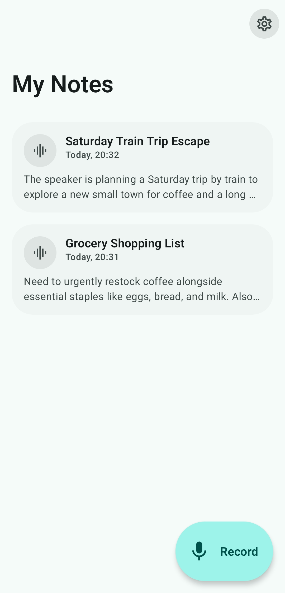
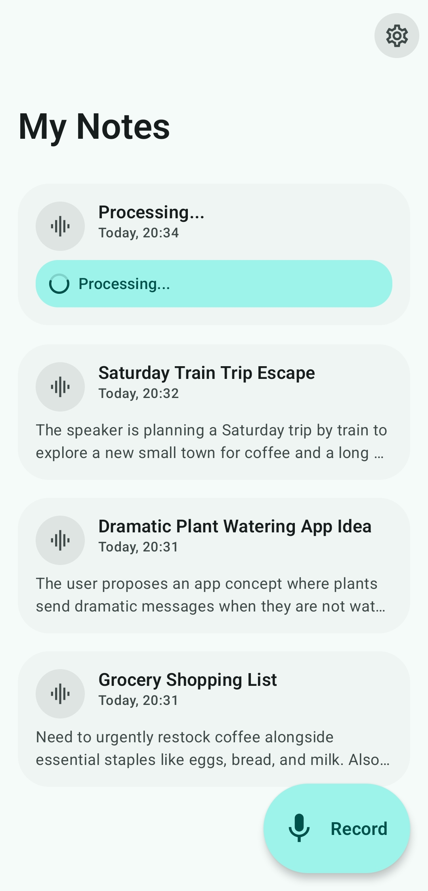
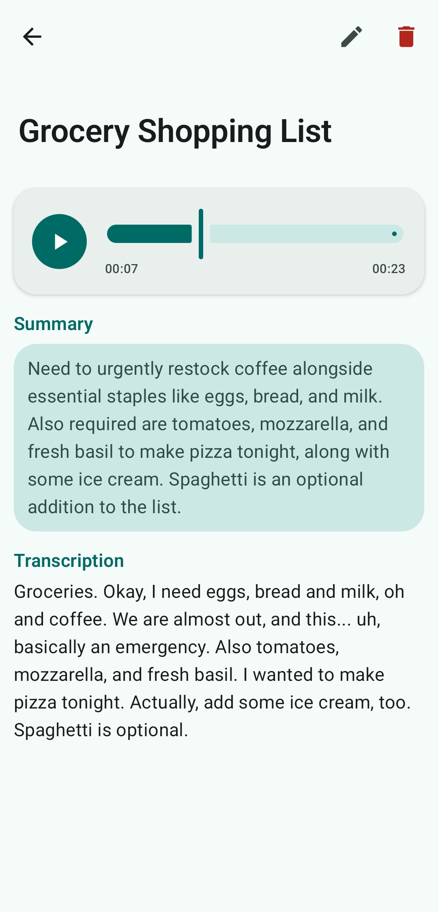
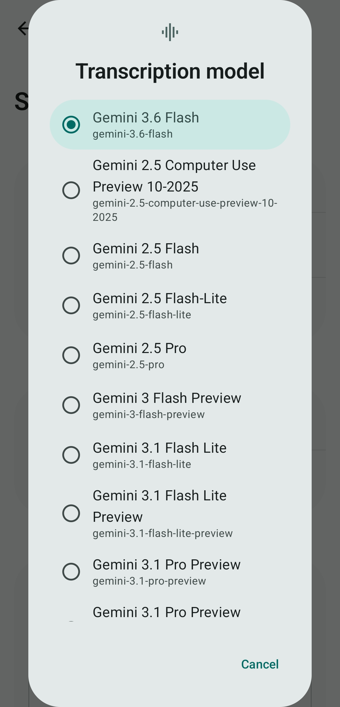
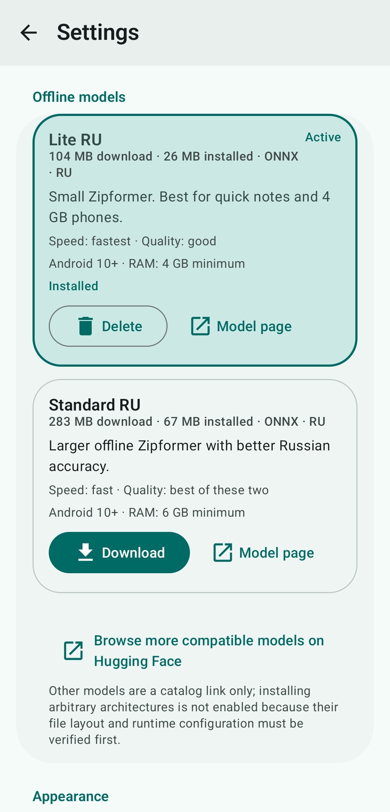
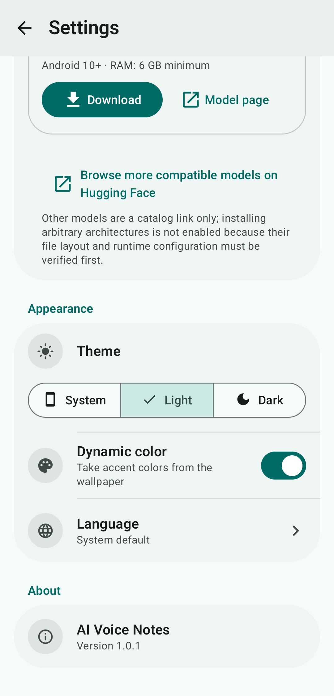

# AI Voice Notes

AI Voice Notes is a native Android app that turns short recordings into searchable notes with a transcription, title, summary, and playable audio. Processing can use Gemini, OpenAI, Groq, or a fully on-device Russian speech-to-text model.

The project focuses on a polished recording flow, recoverable failure states, secure bring-your-own-key storage, and offline inference that does not treat arbitrary model files as interchangeable.

## Product film

Say it messy. AI cleans it up.

https://github.com/user-attachments/assets/1e732031-758c-4114-ad42-767aa66912da

## Download

The latest [AI Voice Notes release](https://github.com/Akbar02Work/AI-Voice-Notes/releases/latest)
includes a debug-signed APK for arm64 Android devices, intended for portfolio evaluation.

## Screenshots

<table>
<tr>
<th>Notes list</th>
<th>Processing</th>
<th>Note details and playback</th>
</tr>
<tr>
<td>
<picture>
  <source media="(prefers-color-scheme: dark)" srcset="screenshots/notes-list-dark.jpg">
  
</picture>
</td>
<td>
<picture>
  <source media="(prefers-color-scheme: dark)" srcset="screenshots/processing-dark.jpg">
  
</picture>
</td>
<td>
<picture>
  <source media="(prefers-color-scheme: dark)" srcset="screenshots/note-details-dark.jpg">
  
</picture>
</td>
</tr>
</table>

<table>
<tr>
<th>Cloud model selection</th>
<th>Offline models</th>
<th>Appearance and language</th>
</tr>
<tr>
<td>
<picture>
  <source media="(prefers-color-scheme: dark)" srcset="screenshots/models-dark.jpg">
  
</picture>
</td>
<td>
<picture>
  <source media="(prefers-color-scheme: dark)" srcset="screenshots/offline-models-dark.jpg">
  
</picture>
</td>
<td>
<picture>
  <source media="(prefers-color-scheme: dark)" srcset="screenshots/settings-dark.jpg">
  
</picture>
</td>
</tr>
</table>

## Highlights

- One-tap AAC recording with clear recording, processing, draft, failure, and retry states
- AI transcription plus generated titles and summaries
- Gemini, OpenAI, and Groq with API-key validation and compatible model discovery
- Russian offline speech-to-text powered by sherpa-onnx and INT8 Zipformer models
- Resumable model downloads with size checks, SHA-256 verification, and atomic activation
- Persistent Room storage with pinned notes and playable original audio
- API keys stored with Android encrypted preferences and excluded from backup
- English and Russian localization
- Material 3 UI with dynamic color and light, dark, and system themes

## Processing modes

| Mode | Transcription | Title and summary | Network |
| --- | --- | --- | --- |
| Gemini | Multimodal `generateContent` | Gemini model selected by the user | Required |
| OpenAI | Audio transcription endpoint | Chat completions | Required |
| Groq | OpenAI-compatible Whisper | OpenAI-compatible chat | Required |
| On device | sherpa-onnx Zipformer | Extractive local processing | Not required after download |

Cloud mode uses a bring-your-own-key model. AI Voice Notes validates the key, discovers compatible models, and stores the selected transcription and summary models separately.

Built by [Akbar Azizov](https://www.akbar02work.xyz) as a portfolio-focused Android project.

[Read the AI Voice Notes case study →](https://www.akbar02work.xyz/projects/voicenotes)

The product film's [Remotion source and render instructions](media/promo-2026-10-v3/README.md)
are included in this repository. Generated exports and dependencies are excluded.
